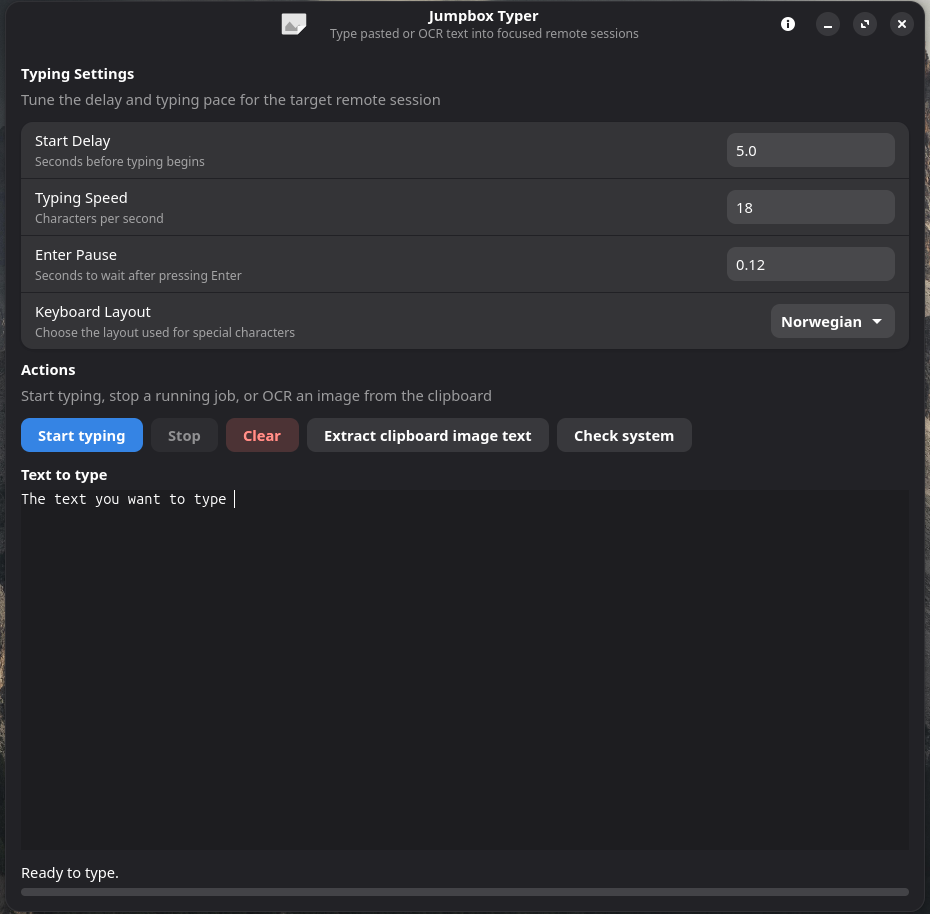

# Jumpbox Typer

Small tool for typing through jump hosts and remote sessions that block clipboard paste.

The app supports Linux and macOS.

For macOS setup and support information, see [README.macos.md](README.macos.md).



## What It Does

- Types pasted text into remote sessions where clipboard paste is blocked
- Extracts plain text from a screenshot of a jump host or terminal
- Helps when the remote session blocks clipboard transfer back to the host

## Install

Download the installer for your platform from the [latest published release](https://github.com/SanderBlom/jumpbox-typer/releases) (including beta releases).

### Debian / Ubuntu (amd64)

1. Download the `.deb` file from the newest release's **Assets** section.
2. Open a terminal in the folder containing the downloaded package and install it:

```bash
sudo apt install ./jumpbox-typer_*_amd64.deb
```

3. Launch **Jumpbox Typer** from your application launcher, or run `jumpbox-typer`.

Use the same command with a newer downloaded package to upgrade. `apt` installs the package's declared dependencies as needed.

The `.deb` is built on Ubuntu 26.04. Older Debian or Ubuntu versions may not provide compatible GTK 4 and libadwaita libraries.

### macOS (Apple Silicon)

Download the `.dmg` file from the same release, open it, and drag **Jumpbox Typer** into **Applications**.

The macOS bundle still requires Homebrew libraries and is ad-hoc signed, not notarized. See [README.macos.md](README.macos.md) for dependencies and keyboard-event permissions.

### Build from source

Release packages do not require cloning this repository or running `install.sh`. For source builds and the local installer, see [BUILD.md](BUILD.md).

The app stores typing preferences in `~/.config/jumpbox-typer/config.txt` by default, or under `XDG_CONFIG_HOME` when set. If that file is missing, the built-in defaults are used.

## Linux window lifecycle

- Closing the main window (including **Ctrl+W**) safely stops typing and leaves the app running.
- Launch Jumpbox Typer again from the desktop launcher or terminal to restore the same window and editor text. This requires a desktop session bus; typing does not resume automatically.
- Use **Main Menu → Quit** or **Ctrl+Q** to exit. If the window is closed, reopen it first to access Quit.
- Closing a dialog closes only that dialog, without stopping typing.
- Editor text is kept only in memory while the app runs. Quit discards it without confirmation; a fresh launch starts empty.

## Safety

The app sends real keystrokes to the focused window when the delay ends.

Later focus changes redirect the remaining text to the newly focused window.

Stop cancels after the current character sequence. It cannot remove text that the app already sent.

Test with harmless text first.
